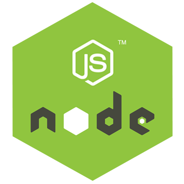

  <div align="right">
    
    
    
    
    
    
    
    
    
  </div>


  <br>

# ApiRest_PedidosYaEnvios_NestJS
Api Rest para la gestión de envíos, productos, puntos, rutas, etc, ejemplificando parte de la arquitectura de desarrollo de PedidosYa Envíos implementado con NestJS, NodeJS, TypeORM, dotenv, cors, swagger, swagger-ui, MySQL, otros.

*   [Repositorio base de datos](https://github.com/andresWeitzel/db_PedidosYaEnvios_MySQL)
*   [Api Doc PedidosYa Envíos](https://developers.pedidosya.com/courier-api/v3#tag/Shippings/paths/~1v3~1shippings~1estimates/post)

<br>

## Índice 📜

<details>
 <summary> Ver </summary>

 <br>

### Sección 1) Descripción, configuración y tecnologías.

*   [1.0) Descripción del Proyecto.](#10-descripción-)
*   [1.1) Ejecución del Proyecto.](#11-ejecución-del-proyecto-)
*   [1.2) Configuración del proyecto desde cero](#12-configuración-del-proyecto-desde-cero-)
*   [1.3) Comandos de utilidad.](#13-comandos-de-utilidad)
*   [1.4) Tecnologías.](#14-tecnologías-)

### Sección 2) Endpoints y Ejemplos

*   [2.0) EndPoints y recursos.](#20-endpoints-y-recursos-)
*   [2.1) Ejemplos.](#21-ejemplos-)

### Sección 3) Prueba de funcionalidad y Referencias

*   [3.0) Prueba de funcionalidad.](#30-prueba-de-funcionalidad-)
*   [3.1) Referencias.](#31-referencias-)

<br>

</details>

<br>

## Sección 1) Descripción, configuración y tecnologías.

### 1.0) Descripción [🔝](#índice-)

<details>
  <summary>Ver</summary>

 <br>

### 1.0.0) Descripción General

### 1.0.1) Descripción Arquitectura y Funcionamiento

<br>

</details>

### 1.1) Ejecución del Proyecto [🔝](#índice-)

<details>
  <summary>Ver</summary>
<br>


<br>

</details>

<br>

### 1.2) Configuración del proyecto desde cero [🔝](#índice-)

<details>
  <summary>Ver</summary>

<br>

*   Creamos un entorno de trabajo a través de algún ide, luego de crear una carpeta nos posicionamos sobre la misma

```git
cd 'projectName'
```

*   Instalamos la última versión LTS de [Nodejs(v18)](https://nodejs.org/en/download)
* Instalamos NestJS de forma global

```git
npm i -g @nestjs/cli
```
* Creamos un proyecto Nest
```git
nest new nombreProyecto
```
* Creamos un proyecto Nest
```git
nest new nombreProyecto
```
* Crear un nuevo modulo sin test

```git
nest g mo moduleName --no-spec
```

* Crear un nuevo servicio sin test

```git
nest g s moduleName --no-spec
```

* Crear un nuevo controlador sin test

```git
nest g co moduleName --no-spec
```

* Podemos automatizar los archivos anteriores con la generación de resources( Esto creara entitie,service,module, controller, etc)

```git
nest g resource resourceName --no-spec
```
```git
- Seleccionamos los siguientes valores
- ? What transport layer do you use? REST API
- ? Would you like to generate CRUD entry points? Yes 
```

* Instalamos el plugin para [dotenv (variables de entorno)](https://www.npmjs.com/package/dotenv)
```git
npm i dotenv
```
* Instalamos el plugin para [TypeORM](https://typeorm.io/) junto con el controlador de mysql para el mapeo de datos.
```git
npm i @nestjs/typeorm typeorm mysql2
```
* Para el uso del orm, podemos seguir la [guía de configuración de typeorm para db](https://docs.nestjs.com/recipes/sql-typeorm).
* Instalamos el plugin de nest con [swagger](https://docs.nestjs.com/openapi/introduction) paa la documentación de nuestra Api rest.
```git
npm i @nestjs/swagger
```
* Instalamos el plugin [class-validator](https://www.npmjs.com/package/class-validator)  para validaciones de tipos de datos, propiedades de clases,  etc.
```git
npm i class-validator
```


<br>

</details>


### 1.3) Comandos de utilidad [🔝](#índice-)

<details>
  <summary>Ver</summary>

 <br>

* Crear un nuevo proyecto NestJs
```git
nest g projectName
```

* Crear un nuevo modulo sin test

```git
nest g mo moduleName --no-spec
```

* Crear un nuevo servicio sin test

```git
nest g s moduleName --no-spec
```

* Crear un nuevo controlador sin test

```git
nest g co moduleName --no-spec
```

* Podemos automatizar los archivos anteriores con la generación de resources( Esto creara entitie,service,module, controller, etc)

```git
nest g resource resourceName --no-spec
```
```git
- Seleccionamos los siguientes valores
- ? What transport layer do you use? REST API
- ? Would you like to generate CRUD entry points? Yes 
```

<br>

</details>

### 1.4) Tecnologías [🔝](#índice-)

<details>
  <summary>Ver</summary>

 <br>

| **Tecnologías** | **Versión** | **Finalidad** |\
| ------------- | ------------- | ------------- |
| [NodeJS](https://nodejs.org/en/) | 14.18.1  | Librería JS |
| [NestJS](https://nestjs.com/) | ^10.0.0 | Framework de NodeJS |
| [Typescript](https://www.typescriptlang.org/) | 3.8.3  | Lenguaje con alto tipado basado en JS |
| [TypeORM](https://typeorm.io/) | ^0.3.17 | ORM |
| [Mysql](https://www.mysql.com/) | 10.1 | SGDB |
| [XAMPP](https://www.apachefriends.org/es/index.html) | 3.2.2 | Paquete de servidores |
| [Swagger](https://docs.nestjs.com/openapi/introduction) | ^7.1.2 | Documentación de Api |
| [VSC](https://code.visualstudio.com/docs) | 1.72.2  | IDE |
| [Postman](https://www.postman.com/downloads/) | 10.11  | Cliente Http |
| [CMD](https://learn.microsoft.com/en-us/windows-server/administration/windows-commands/cmd) | 10 | Símbolo del Sistema para linea de comandos |
| [Git](https://git-scm.com/downloads) | 2.29.1  | Control de Versiones |

</br>

| **Extensión** |\
| -------------  |
| Prettier - Code formatter |
| Typescript Toolbox - generate setters, getters, constrc, etc |
| Otras |

<br>

</details>

<br>

## Sección 2) Endpoints y Ejemplos.

### 2.0) Endpoints y recursos [🔝](#índice-)

<details>
  <summary>Ver</summary>

<br>

</details>

### 2.1) Ejemplos [🔝](#índice-)

<details>
  <summary>Ver</summary>
<br>

<br>

</details>

<br>

## Sección 3) Prueba de funcionalidad y Referencias.

### 3.0) Prueba de funcionalidad [🔝](#índice-)

<details>
  <summary>Ver</summary>

<br>

<br>

</details>

### 3.1) Referencias [🔝](#índice-)

<details>
  <summary>Ver</summary>

 <br>

#### Videotutorials

- [Videotutorial base](https://www.youtube.com/watch?v=W4_oH3anYHU)
- [Videotutorial Typeorm](https://www.youtube.com/watch?v=JaTbzPcyiOE)
- [Mastering Nest.js](https://www.youtube.com/playlist?list=PLkZU2rKh1mT-3VvYvGCdRVCCJ5lCtOKED)

#### Api example code

- [Api completa MVC (CHECK)](https://github.com/amitavdevzone/nest-js-quiz-manager/tree/master)
- [Api example tutorial](https://stackabuse.com/guide-to-nestjs-building-a-rest-api-with-nest-and-node/)
- [Nestjs Rest example code](https://github.com/hantsy/nestjs-rest-sample/blob/master/docs/guide.md)
- [OFICIAL CRUD NESTJS](https://docs.nestjs.com/recipes/crud-generator)

#### Api Methods

- [findOne, find, filter,etc](https://desarrolloweb.com/articulos/metodo-find-repositorios-typeorm)
- [Check pagination,etc](https://stackoverflow.com/questions/53922503/how-to-implement-pagination-in-nestjs-with-typeorm)
- [Rest Methods](https://docs.nestjs.com/techniques/database)

#### Topics NestJS

- [Using async and promises](https://subscription.packtpub.com/book/programming/9781800204737/10/ch10lvl1sec89/asynchronous-handlers)
- [Query parameters and parameters](https://stackoverflow.com/questions/54958244/how-to-use-query-parameters-in-nest-js)
- [Using query parameters](https://dev.to/nandhakumar/nest-js-tutorial-3-query-route-params-3gi4)
- [Autovalidation in NestJS](https://docs.nestjs.com/techniques/validation)
- [Exceptions & filters](https://www.youtube.com/watch?v=AWqqg9Dtnc4)
- [ Other Exceptions & filters](https://www.youtube.com/watch?v=4akOFpItbLc)

#### OpenApi and Swagger

- [Code settings](https://docs.nestjs.com/openapi/introduction)
- [Code example](https://github.com/nestjs/nest/blob/master/sample/11-swagger/src/cats/entities/cat.entity.ts)


#### Typeorm Relations
- [Typeorm Relationships with cascade](https://stackoverflow.com/questions/55098023/typeorm-cascade-option-cascade-ondelete-onupdate)
- [Using Foreign keys tutorial](https://leoromanovsky.medium.com/a-blog-without-an-author-typeorm-creates-confusion-with-required-columns-and-optional-foreign-keys-1a3f932d4e67)
- [Using Foreign keys stackoverflow](https://stackoverflow.com/questions/68556933/typeorm-insert-foreign-key-by-string)
- [Using Providers with Nestjs](https://docs.nestjs.com/recipes/sql-typeorm)

#### Librerías
- [Habilitar y configurar validaciones con Nestjs](https://betterprogramming.pub/validating-complex-requests-with-nestjs-a-practical-example-b55c287f7c99)
-  [Validación de campos](https://www.npmjs.com/package/node-input-validator)
-  [Validación de propiedades de clases](https://www.npmjs.com/package/class-validator)
- [Validación con enumerados](https://snyk.io/advisor/npm-package/class-validator/functions/class-validator.IsEnum)
- [Validación con fechas](https://stackoverflow.com/questions/68931716/isdatestring-class-validator-nestjs)
- @nestjs/common
  - [Enumeration HttpStatus](http://nestjs-doc.exceptionfound.com/enums/httpstatus.html)
  


<br>

</details>
